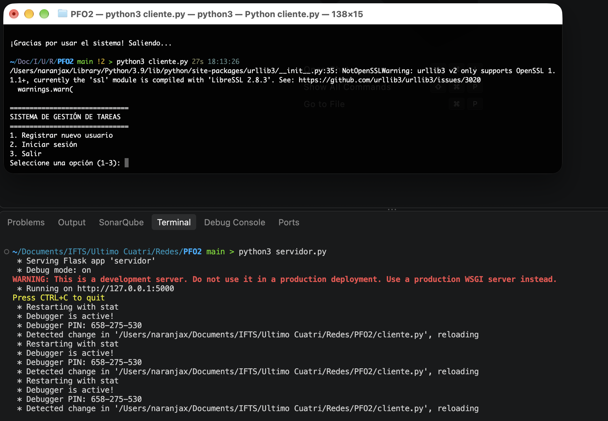
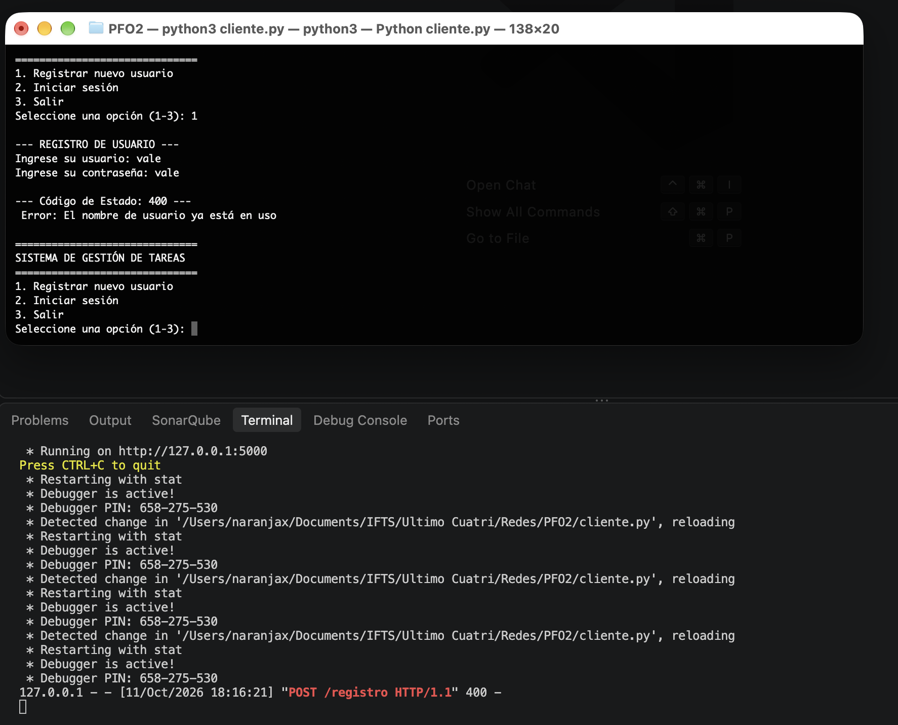
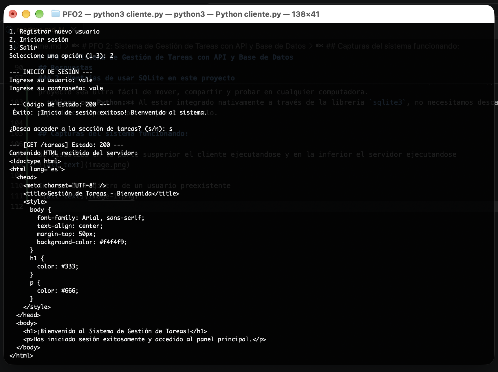
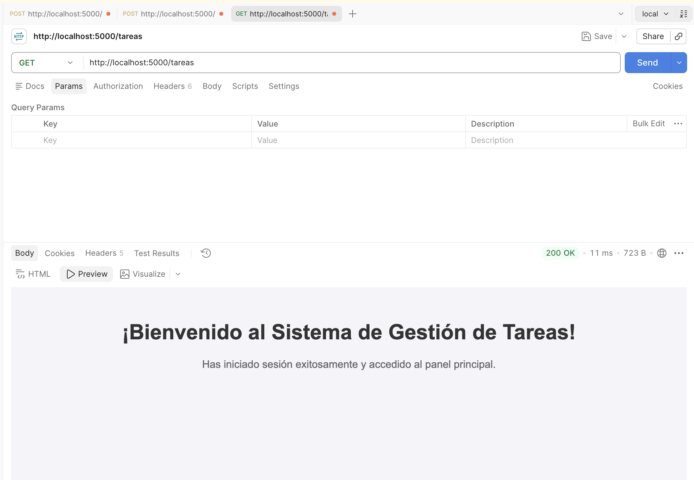

# PFO 2: Sistema de Gestión de Tareas con API y Base de Datos

Este proyecto es una aplicación cliente-servidor desarrollada en Python que implementa una API REST utilizando **Flask**, persistencia de datos local con **SQLite**, autenticación segura con contraseñas hasheadas y un cliente interactivo por consola.

---

## 📂 Estructura del Proyecto

El proyecto está diseñado bajo una arquitectura modular y limpia:

```text
PFO2/
│
├── helpers/
│   └── validations.py       # Funciones auxiliares de validación de entradas
│
├── routes/
│   ├── auth_routes.py       # Endpoints de autenticación (/registro, /login)
│   └── tasks_routes.py      # Endpoints de gestión de tareas (/tareas)
│
├── templates/
│   └── tareas.html          # Plantilla HTML de bienvenida
│
├── cliente.py               # Cliente en consola interactivo
├── servidor.py              # Archivo principal de la API Flask
├── database.db              # Base de datos SQLite (se genera automáticamente)
└── README.md                # Documentación del proyecto
```

---

## 🛠️ Requisitos e Instalación

Asegúrate de tener instalado **Python** (versión 3.9 o superior) en tu computadora.

### 1. Clonar o descargar el repositorio

Descarga o ubícate en la carpeta raíz del proyecto en tu terminal.

### 2. Instalar las dependencias necesarias

El servidor utiliza **Flask** para la API y el manejo de bases de datos, mientras que el cliente de consola utiliza **`requests`** para comunicarse con el servidor.

Ejecuta el siguiente comando en tu terminal para instalar ambas dependencias:

```bash
python3 -m pip install flask requests
```

## Cómo Ejecutar el Proyecto

Para ejecutar y probar el sistema, necesitarás abrir **dos terminales independientes**: una para el servidor (API) y otra para el cliente en consola.

### 1. Iniciar el Servidor API

Abre una terminal en la carpeta raíz del proyecto y ejecuta el servidor Flask:

```bash
python3 servidor.py
```

Esto iniciará la API en http://localhost:5000 y creará automáticamente el archivo de base de datos local database.db.

### 2. Ejecutar el Cliente en Consola

Abre otra pestaña o ventana de la terminal (manteniendo la del servidor encendida) y ejecuta el cliente interactivo:

```bash
python3 cliente.py
```

Desde el menú interactivo que aparecerá en la consola podrás:

Registrar un nuevo usuario.

Iniciar sesión con tus credenciales.

Acceder a la ruta protegida de tareas (GET /tareas), que descargará y mostrará el código HTML de bienvenida proporcionado por el servidor.

---

## 📌 Nota sobre el Despliegue y GitHub Pages

Es importante aclarar que este proyecto **no puede ser alojado en GitHub Pages**. Los motivos técnicos son los siguientes:

1. **Naturaleza Estática vs. Backend:** GitHub Pages es un servicio diseñado exclusivamente para alojar sitios web estáticos (HTML, CSS y JS). Este proyecto cuenta con un servidor backend desarrollado en **Python (Flask)** que requiere ejecución en tiempo de servidor para procesar las peticiones HTTP de los endpoints (`/registro`, `/login`, `/tareas`).
2. **Persistencia Local:** La aplicación utiliza una base de datos local basada en **SQLite** (`database.db`), la cual requiere acceso al sistema de archivos del servidor para realizar las operaciones de lectura y escritura.
3. **Arquitectura Cliente-Servidor:** El sistema depende de la interacción en tiempo real entre un servidor activo por terminal y un cliente de consola independiente (`cliente.py`) que se comunica mediante solicitudes HTTP locales. Por lo tanto, el entorno de ejecución debe ser local.

## Respuestas

### 1. ¿Por qué hashear contraseñas?

Nunca debemos guardar las contraseñas de los usuarios tal cual las escriben (en texto plano) en la base de datos. Si alguien logra entrar o robar el archivo, vería todas las claves.
Hashear la contraseña significa pasarla por una función matemática que la convierte en un código cifrado e irreversible (un hash). Si la base de datos se filtra, los atacantes solo van a ver una cadena ilegible y no las contraseñas reales. Además, al usar herramientas como `werkzeug.security`, nos aseguramos de aplicar buenas prácticas de seguridad de forma sencilla.

### 2. Ventajas de usar SQLite en este proyecto

SQLite se utiliza porque es la opción más práctica y limpia para este tipo de proyectos por varias razones:

- **No necesita instalación:** A diferencia de otras bases de datos más grandes (como MySQL o PostgreSQL), SQLite no requiere instalar ni configurar ningún servidor externo.
- **Todo en un archivo:** Guarda absolutamente toda la información en un único archivo local (`database.db`), lo que hace que el proyecto sea ultra fácil de mover, compartir y probar en cualquier computadora.
- **Viene con Python:** Al estar integrado nativamente a través de la librería `sqlite3`, no necesitamos descargar conectores raros ni dependencias pesadas para empezar a usarlo.

## Capturas del sistema funcionando:

Se visualiza en la parte susperior el cliente ejecutandose y en la inferior el servidor ejecutandose


Intento de registro de un usuario preexistente


Inicio de sesión exitoso


Si bien en el inicio de sesión devuelve un HTML aquí podemos visualizar como se vería en caso de renderizarse:

